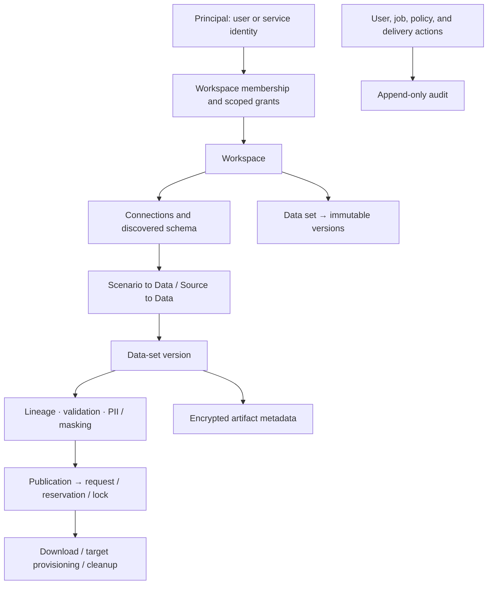

# TIGR MVP1 — Backend Data Schema Design

**Purpose:** Define a PostgreSQL-first persistence model for every MVP1 feature in the TIGR Business Requirements baseline.  
**Source:** `1-TIGR_MVP1_Business_Requirements_baseline.md`  
**Scope:** MVP1 only. Expansion epics are intentionally excluded.  
**Status:** Proposed logical and physical design for implementation review.

## 1. Design principles

1. **The data set is the primary business object.** A run, output file, reservation, lock, or export is associated with a data-set version and never substitutes for the data-set record.
2. **Workspace is the tenant and authorization boundary.** Workspace-owned records carry `workspace_id`; references across workspaces are rejected by composite foreign keys or service-layer validation.
3. **PostgreSQL is authoritative.** Store transactional state, policies, jobs, access, audit, validation evidence, and lineage in PostgreSQL. Neo4j is an optional derived projection; it is not the system of record.
4. **Make versions immutable after publication.** Edits create a new version. Record the version used by every job, policy, mapping, reservation, lock, delivery, and lineage event.
5. **Use explicit relationships for core business facts.** JSONB is for provider-specific configuration, structured criteria, and non-sensitive extensibility, not for replacing relational keys or authorization rules.
6. **Store artifact references, not dataset bytes.** Put source samples, generated data, exports, and uploaded policy files in encrypted object storage. PostgreSQL stores metadata, opaque storage keys, checksums, and retention state.
7. **Use UTC timestamps and opaque identifiers.** Use UUID primary keys, `timestamptz`, and separate human-readable names/codes where needed.
8. **Keep secrets and raw PII out of the database.** Connections retain secret-manager references only. Avoid raw sensitive values in logs, lineage, audit details, prompts, previews, and exports.
9. **Do not derive authorization from UI visibility.** Apply role, workspace, object grant, status, and validity-window checks in API queries and background workers before returning or aggregating data.
10. **Keep lifecycle changes auditable.** Use domain status plus append-only status history or audit events; do not rely on a mutable `updated_by` field as the only evidence.

## 2. Recommended database namespaces

Use one PostgreSQL database with logical schemas to group migrations and ownership. This is not a recommendation to deploy separate databases or services.

| PostgreSQL schema | Owns |
|---|---|
| `iam` | Users, service identities, role assignments, scoped access grants |
| `workspace` | Workspaces and membership/access scope |
| `connector` | Source/target connections, tests, schema snapshots and discovered objects/fields |
| `dataset` | Data sets, immutable versions, version fields, mappings, scenario specifications, publications |
| `execution` | Jobs, job steps, validation, provisioning and cleanup runs |
| `privacy` | Field classifications, masking policies/versions/rules, masking runs and results |
| `usage` | Data requests, approvals, reservations, locks, downloads/integrations |
| `lineage` | Version-level lineage nodes, edges and events |
| `audit` | Append-only user and service activity |
| `artifact` | Metadata for encrypted object-storage artifacts |

If the repository already uses a single `public` schema or another migration convention, keep its convention and retain these as logical modules. Avoid a disruptive namespace migration solely to match this proposal.

## 3. Conceptual model



Both creation paths produce a `dataset.dataset_version` and then use common lineage, privacy, validation, publication, and consumption records:

- **Scenario to Data:** natural-language requirement → reviewed schema/field plan → approved source-backed or synthetic generation → version.
- **Source to Data:** approved source and mapping → selected required fields and criteria → generation/provisioning → version.

## 4. Entity and relationship catalogue

All primary keys below are UUIDs unless a table is explicitly an append-only event with a generated `bigint` sequence. Include `created_at`, `updated_at`, and actor columns where the record is mutable. Use `created_by_principal_id`/`updated_by_principal_id` so user and service activity can be represented consistently.

### 4.1 Identity, roles, workspaces, and access

| Table | Important columns | Purpose and constraints |
|---|---|---|
| `iam.principal` | `id`, `principal_type` (`USER`/`SERVICE`), `status`, timestamps | Common subject for authorization and audit. Principal type is immutable. |
| `iam.app_user` | `principal_id` PK/FK, `oidc_subject` unique, `email`, `display_name`, `last_login_at` | User profile keyed to the enterprise identity provider subject. Do not use email as the permanent identity key. |
| `iam.service_identity` | `principal_id` PK/FK, `name`, `owner_principal_id`, `purpose`, `secret_ref`, `expires_at` | Non-human identity with explicit owner, purpose, and lifecycle. `secret_ref` is an opaque reference only. |
| `workspace.workspace` | `id`, `name`, `purpose`, `status`, `created_by_principal_id` | Admin-managed workspace. Unique active name within the agreed bank scope; deactivate instead of deleting referenced workspaces. |
| `workspace.membership` | `workspace_id`, `principal_id`, `role`, `valid_from`, `valid_until`, `status`, `granted_by` | Role in a workspace: `TEST_DATA_ENGINEER` or `QA_ENGINEER`; optional validity window. A person may have different roles in different workspaces. Admin is a platform role (below), not silently inferred from workspace membership. |
| `iam.platform_role_assignment` | `principal_id`, `role` (`ADMIN`), validity/status, `granted_by` | Explicit platform-wide Admin assignment, time-bounded and audited. |
| `iam.object_access_grant` | `id`, `principal_id`, target FK(s), `permission`, `valid_from`, `valid_until`, `status`, `granted_by`, `reason` | Optional direct/time-bound access to a data set, reservation, or lock. Exactly one target FK is populated; add a `CHECK` enforcing this. Never let a direct grant override a revoked principal or workspace membership. |
| `iam.role_permission` | `role`, `permission_code`, `scope_type` | Optional seeded permission catalogue for consistent API authorization. Treat it as policy configuration, not a substitute for scope checks. |

**Role scope:** Admin can create/manage workspaces and has global activity visibility. Test Data Engineer works only in authorized workspaces, creates/configures/publishes data sets, reviews PII findings, and manages policies. QA Engineer can discover only authorized published versions, request/reserve/lock/use them, and sees only their own Dashboard activities. Store actor identity on every action.

**Access grant FK design:** Prefer typed nullable FKs (`workspace_id`, `dataset_id`, `reservation_id`, `lock_id`) over a polymorphic `object_type/object_id`. Add a check constraint requiring exactly one scope. If the codebase needs a different grant pattern, preserve referential integrity and implement equivalent scope validation.

### 4.2 Connections and schema discovery

| Table | Important columns | Purpose and constraints |
|---|---|---|
| `connector.connection` | `id`, `workspace_id`, `connection_kind`, `data_format`, `name`, `environment`, `purpose`, `permitted_operations`, `secret_ref`, `lifecycle_status`, `enabled_at`, `created_by` | Registered source, target, or source/target endpoint. Kinds include relational database, JSON, CSV, delimited text. Credentials never stored here. Only `TESTED` and explicitly `ENABLED` connections are usable by jobs. |
| `connector.connection_test` | `id`, `workspace_id`, `connection_id`, `requested_by`, `started_at`, `finished_at`, `outcome`, `safe_error_code`, `safe_message`, `correlation_id` | Append-only test/access-validation result. Never persist passwords, SQL with data literals, raw file lines, or secret-bearing provider errors. |
| `connector.schema_snapshot` | `id`, `workspace_id`, `connection_id`, `snapshot_no`, `captured_at`, `status`, `source_version`, `metadata_digest` | Versioned discovery of relational schema or file structure. Unique `(connection_id, snapshot_no)`. |
| `connector.schema_object` | `id`, `workspace_id`, `schema_snapshot_id`, `parent_object_id`, `object_name`, `object_kind`, `object_path`, `ordinal` | Table, view, JSON object/array, file, or logical record. `object_path` supports nested structures; no sample values. |
| `connector.schema_field` | `id`, `workspace_id`, `schema_object_id`, `field_name`, `field_path`, `data_type`, `nullable`, `key_kind`, `ordinal`, `constraints_json` | Discovered field metadata, keys, and safe constraints. Unique field path within an object. Do not place PII sample values in metadata. |

Connection lifecycle: `DRAFT → CONFIGURED → TESTED → ENABLED`; failed validation remains non-usable. Changes to endpoint or secret reference invalidate the prior test and require a new test before enablement. Source inventory and metadata exports should be generated from these records and masked as required.

### 4.3 Dataset, mappings, and creation workflows

| Table | Important columns | Purpose and constraints |
|---|---|---|
| `dataset.dataset` | `id`, `workspace_id`, `name`, `description`, `owner_principal_id`, `created_by`, `current_version_id`, `lifecycle_status`, `expires_at` | Stable catalog identity. Unique name policy should be decided per workspace. `current_version_id` points only to a version belonging to this data set. |
| `dataset.dataset_version` | `id`, `workspace_id`, `dataset_id`, `version_no`, `creation_path`, `status`, `schema_snapshot_id`, `mapping_version_id`, `created_from_job_id`, `record_count`, `created_at`, `published_at`, `expires_at` | Immutable snapshot of an output; unique `(dataset_id, version_no)`. Path is `SCENARIO_TO_DATA` or `SOURCE_TO_DATA`. States include `DRAFT`, `PROCESSING`, `VALIDATING`, `READY_FOR_REVIEW`, `PUBLISHED`, `FAILED`, `EXPIRED`, `RETIRED`. Published data is not edited in place. |
| `dataset.dataset_field` | `id`, `workspace_id`, `dataset_version_id`, `field_name`, `field_path`, `data_type`, `required`, `source_schema_field_id`, `target_field_path`, `constraint_spec`, `ordinal` | Versioned output schema and per-field required mapping. For Source to Data, this records selected required fields and the source-to-output mapping. A composite unique key prevents duplicate output paths per version. |
| `dataset.mapping` | `id`, `workspace_id`, `name`, `source_connection_id`, `source_schema_snapshot_id`, `status`, owner/timestamps | Reusable mapping identity scoped to one workspace and source. |
| `dataset.mapping_version` | `id`, `workspace_id`, `mapping_id`, `version_no`, `status`, `created_by`, `approved_by`, `approved_at` | Immutable approved mapping version; jobs bind to this exact version. |
| `dataset.mapping_field` | `id`, `workspace_id`, `mapping_version_id`, `source_schema_field_id`, `target_field_path`, `transform_type`, `transform_config`, `required`, `ordinal` | Field-level mapping and approved transformation metadata. Transform config must not contain secrets or row-level values. |
| `dataset.scenario_spec` | `id`, `workspace_id`, `dataset_version_id`, `requirement_text_ref`, `scenario_json`, `generation_mode`, `model_config_version`, `approved_by`, `approved_at` | Reviewed scenario/requirements for Scenario to Data. Prefer artifact reference or sanitized text if user requirement can contain sensitive data; capture model/template version, not hidden chain-of-thought. |
| `dataset.source_to_data_spec` | `id`, `workspace_id`, `dataset_version_id`, `source_connection_id`, `schema_snapshot_id`, `mapping_version_id`, `criteria_json`, `requested_volume`, `target_connection_id`, `approved_by`, `approved_at` | Source to Data inputs, required-field selection, criteria, volume, and optional target. Structured criteria must be parameterized; never persist executable unreviewed SQL. |
| `dataset.publication` | `id`, `workspace_id`, `dataset_version_id`, `published_by`, `published_at`, `state`, `readiness_snapshot_json`, `withdrawn_by`, `withdrawn_at`, `reason` | Explicit Test Data Engineer publication/withdrawal decision and the checks that were true at release. One active publication per version; enforce required gates transactionally. |
| `dataset.version_status_history` | `id`, `workspace_id`, `dataset_version_id`, `from_status`, `to_status`, `changed_by`, `changed_at`, `reason`, `correlation_id` | Append-only lifecycle history; transitions validated in the domain service and optionally by a transition table. |

Do not put full dataset records in `dataset_field` or JSONB inside PostgreSQL. Generated data should be stored as protected artifacts; include only schema and non-sensitive summary metadata in relational rows.

### 4.4 Jobs, validation, provisioning, and cleanup

| Table | Important columns | Purpose and constraints |
|---|---|---|
| `execution.job` | `id`, `workspace_id`, `job_type`, `status`, `requested_by`, `dataset_id`, `dataset_version_id`, `idempotency_key`, `correlation_id`, `submitted_at`, `started_at`, `finished_at`, `retry_of_job_id`, `safe_error_code` | Durable execution for discovery, generation, masking, validation, provisioning, export, graph sync, or cleanup. Unique idempotency key per workspace/operation. Keep status and lifecycle history queryable. |
| `execution.job_step` | `id`, `workspace_id`, `job_id`, `step_key`, `sequence_no`, `status`, `started_at`, `finished_at`, `attempt`, `safe_metrics_json`, `safe_error_code` | Progress and safe operational metrics. Never save raw PII or secret-bearing exception text. |
| `execution.job_event` | `id` (bigint), `workspace_id`, `job_id`, `event_type`, `occurred_at`, `safe_payload_json` | Append-only event stream for job progress and troubleshooting. |
| `execution.validation_run` | `id`, `workspace_id`, `dataset_version_id`, `job_id`, `validation_type`, `status`, `started_at`, `completed_at`, `summary_json` | Validation pass for schema, required fields, constraints, relationships, privacy, target connectivity/schema, and record counts. |
| `execution.validation_result` | `id`, `workspace_id`, `validation_run_id`, `check_code`, `severity`, `status`, `field_path`, `safe_message`, `observed_count`, `expected_summary` | Field/check-level evidence. Avoid raw offending values; use redacted examples only if policy permits. |
| `execution.provisioning_run` | `id`, `workspace_id`, `dataset_version_id`, `job_id`, `target_connection_id`, `target_schema_ref`, `mode`, `status`, `started_at`, `completed_at`, `records_written`, `cleanup_due_at` | Delivery to an approved database or file target; binds exact dataset version and target. Record outcome and cleanup eligibility. |
| `execution.cleanup_run` | `id`, `workspace_id`, `provisioning_run_id`, `job_id`, `status`, `started_at`, `completed_at`, `evidence_ref` | Controlled removal/expiry cleanup with auditable completion evidence. |

Dashboard job counts should query `execution.job` using the authenticated principal’s permitted workspace/object scope. Do not store a second mutable dashboard count as business truth. A cache/materialized view may be added later with a defined refresh and authorization strategy.

### 4.5 PII discovery and masking

| Table | Important columns | Purpose and constraints |
|---|---|---|
| `privacy.field_classification` | `id`, `workspace_id`, `schema_field_id`, `classification`, `confidence`, `discovery_method`, `status`, `reviewed_by`, `reviewed_at`, `policy_version` | PII/sensitive classification for discovered source or output fields; supports AI/heuristic suggestion plus human correction. No sample data. |
| `privacy.masking_policy` | `id`, `workspace_id`, `name`, `description`, `status`, `owner_principal_id`, `created_at` | Policy identity; only enabled approved policies can be enforced. |
| `privacy.masking_policy_version` | `id`, `workspace_id`, `policy_id`, `version_no`, `status`, `source_artifact_id`, `created_by`, `reviewed_by`, `approved_at` | Immutable version, including uploaded policy reference and approval evidence. Unique `(policy_id, version_no)`. |
| `privacy.masking_rule` | `id`, `workspace_id`, `policy_version_id`, `field_path` or `classification`, `method`, `parameters_json`, `consistency_group`, `enabled` | Field-level method: tokenization, substitution, redaction, date shifting, numeric transform. Exactly one field selector strategy; parameters exclude source values and keys. |
| `privacy.masking_run` | `id`, `workspace_id`, `dataset_version_id`, `policy_version_id`, `job_id`, `status`, `started_at`, `completed_at`, `validation_run_id` | Applied masking evidence against one immutable dataset version and exact policy version. |
| `privacy.masking_result` | `id`, `workspace_id`, `masking_run_id`, `rule_id`, `field_path`, `status`, `processed_count`, `rejected_count`, `safe_summary` | Safe, aggregate outcome by rule/field; no original or masked sample values. |

Publication readiness must evaluate applicable requirements: classification reviewed, approved policy selected, masking complete when required, and masking/validation checks passed. Store the policy version used on the version and lineage; later policy edits do not rewrite past evidence.

### 4.6 Requests, approvals, reservations, locks, and consumption

| Table | Important columns | Purpose and constraints |
|---|---|---|
| `usage.data_request` | `id`, `workspace_id`, `dataset_id`, `requested_version_id`, `requester_principal_id`, `purpose`, `requested_start`, `requested_end`, `status`, `created_at` | Optional configured request/approval workflow before reservation/use. |
| `usage.approval` | `id`, `workspace_id`, `request_id`, `approver_principal_id`, `decision`, `decided_at`, `comment_ref` | Append-only approval decisions; define allowed approver scope in the service. |
| `usage.reservation` | `id`, `workspace_id`, `dataset_version_id`, `principal_id`, `request_id`, `starts_at`, `ends_at`, `status`, `created_at`, `released_at` | Planned future use. Enforce `starts_at < ends_at`, granted access for the interval, authorized published version, and status transitions. Overlap policy should be configurable; exclusive use is enforced by locks. |
| `usage.dataset_lock` | `id`, `workspace_id`, `dataset_version_id`, `principal_id`, `reservation_id`, `acquired_at`, `lease_expires_at`, `released_at`, `status`, `fencing_token`, `override_reason`, `overridden_by` | Exclusive active lease during use. Use monotonic fencing tokens to reject stale workers. Partial unique index permits only one active lock per data-set version (or per allocation if allocation granularity is introduced). Admin override requires a reason and audit event. |
| `usage.consumption_event` | `id` (bigint), `workspace_id`, `dataset_version_id`, `principal_id`, `reservation_id`, `lock_id`, `event_type`, `target_connection_id`, `artifact_id`, `occurred_at`, `outcome`, `correlation_id` | Download, automation-suite integration, target handoff, release, expiry, or denial event. No signed URLs or sensitive file content in this table. |

Time-bounded grants are valid only if `valid_from <= now()` and (`valid_until` is null or `valid_until > now()`). A job must re-check access and grant validity when it starts and before publishing or delivering, not only at submission.

### 4.7 Lineage and audit

| Table | Important columns | Purpose and constraints |
|---|---|---|
| `lineage.lineage_node` | `id`, `workspace_id`, `dataset_version_id`, `node_type`, typed FK columns for connection/schema/mapping/job/policy/masking/validation/publication/target/artifact, `label`, `occurred_at`, `safe_metadata_json` | A node in the version-level lineage view. Use typed nullable FKs and a check requiring exactly one referenced entity (except a version-root node). Never put raw values, SQL literals, prompts containing PII, or secrets in metadata. |
| `lineage.lineage_edge` | `id`, `workspace_id`, `dataset_version_id`, `from_node_id`, `to_node_id`, `edge_type`, `sequence_no` | Directed, ordered dependency/processing relation. Both nodes must belong to the same workspace and dataset version; prevent self-edges and duplicate edges. |
| `lineage.lineage_event` | `id` (bigint), `workspace_id`, `dataset_version_id`, `actor_principal_id`, `event_type`, `occurred_at`, `correlation_id`, `safe_details_json` | Append-only user-visible and audit-relevant event supporting a readable lineage timeline. |
| `audit.audit_event` | `id` (bigint), `workspace_id` nullable for platform actions, `actor_principal_id`, `actor_role_snapshot`, `action`, `object_type`, `object_id`, `outcome`, `occurred_at`, `correlation_id`, `safe_metadata_json` | Append-only record of authentication context, workspace/grant changes, connection tests, mappings, data operations, privacy decisions, publication, downloads, locks, overrides, and cleanup. Use a snapshot of role/scope at action time. |

**Lineage content by path:**

- Scenario to Data: approved scenario/specification → schema snapshot and mapping → source query or model configuration → generation job → output version/artifact → masking and validation → publication → delivery/consumption.
- Source to Data: source connection and schema snapshot → saved mapping version → selected required fields and criteria → extraction/provisioning job → output version/artifact → masking and validation → publication → target/download events.

Persist lineage in PostgreSQL transactionally with domain events. Neo4j may project these nodes and edges asynchronously using an outbox; reconciliation must rebuild the graph from PostgreSQL. Do not make Neo4j availability a condition for losing or failing to persist a successful primary transaction.

### 4.8 Artifacts and file lifecycle

| Table | Important columns | Purpose and constraints |
|---|---|---|
| `artifact.artifact` | `id`, `workspace_id`, `dataset_version_id` (nullable for workspace-level uploads such as masking policies), `artifact_type`, `storage_key`, `storage_provider`, `encryption_key_ref`, `content_type`, `size_bytes`, `checksum`, `classification`, `status`, `created_at`, `expires_at`, `deleted_at` | Pointer to encrypted object/file storage for generated outputs, protected previews, reports, exports, or uploaded policies. Restrict access through API; never expose storage key as a public URL. |
| `artifact.artifact_access_event` | `id` (bigint), `artifact_id`, `principal_id`, `action`, `occurred_at`, `outcome`, `correlation_id` | Optional artifact-level access evidence; align with `usage.consumption_event` to avoid duplicate business events. |

Use short-lived signed download URLs created only after authorization, publication, privacy, reservation/lock, and expiry checks. Store no signed URL in PostgreSQL. Track retention/expiry and cleanup completion.

## 5. Key constraints and indexes

### 5.1 Integrity constraints

- `UNIQUE (oidc_subject)` for users; do not merge users solely because email addresses match.
- `UNIQUE (workspace_id, normalized_name)` for workspace-scoped connections, mappings, policies, and data sets where product rules require unique names.
- `UNIQUE (dataset_id, version_no)`, `UNIQUE (mapping_id, version_no)`, `UNIQUE (policy_id, version_no)`, and `UNIQUE (connection_id, snapshot_no)`.
- Composite foreign keys include `workspace_id`, for example `(workspace_id, dataset_id)` → `dataset(dataset.workspace_id, dataset.id)`. Add the corresponding unique key on the referenced table. This prevents cross-workspace references at the database boundary.
- Use `CHECK (valid_until IS NULL OR valid_until > valid_from)` and `CHECK (ends_at > starts_at)`.
- Require `dataset_version.dataset_id` to match the parent data set workspace; status transitions are validated in a transaction.
- Add a partial unique index on active locks, for example `UNIQUE (workspace_id, dataset_version_id) WHERE status = 'ACTIVE'`.
- Add job idempotency uniqueness on `(workspace_id, job_type, idempotency_key)` for non-null keys.
- Use restrictive delete behavior for referenced workspaces, versions, policies, and audit records. Prefer soft deactivation/expiry plus controlled retention jobs. Do not cascade-delete audit or lineage evidence.

### 5.2 Query indexes

Add indexes based on actual query plans; initial candidates:

- `workspace.membership(principal_id, workspace_id, status, valid_from, valid_until)`.
- `iam.object_access_grant(principal_id, status, valid_from, valid_until)` plus indexes for each typed target FK.
- `connector.connection(workspace_id, connection_kind, lifecycle_status)`.
- `connector.schema_object(schema_snapshot_id, parent_object_id)` and `connector.schema_field(schema_object_id, ordinal)`.
- `dataset.dataset(workspace_id, lifecycle_status, updated_at DESC)`.
- `dataset.dataset_version(dataset_id, version_no DESC)` and `(workspace_id, status, created_at DESC)`.
- `execution.job(workspace_id, status, submitted_at DESC)` and `(requested_by, submitted_at DESC)`.
- `usage.reservation(workspace_id, dataset_version_id, status, starts_at, ends_at)`.
- Partial active-lock index described above.
- `lineage.lineage_node(dataset_version_id, occurred_at)` and `lineage.lineage_edge(dataset_version_id, sequence_no)`.
- `audit.audit_event(workspace_id, occurred_at DESC)`, `(actor_principal_id, occurred_at DESC)`, and `(object_type, object_id, occurred_at DESC)`.
- GIN indexes only for JSONB fields that have real query requirements. Do not index arbitrary user text or sensitive prompt fields by default.

## 6. Representative PostgreSQL DDL

The DDL illustrates high-value constraints. It is not a substitute for adapting naming, migration conventions, and repository identity types after Phase 0. Use `gen_random_uuid()` if enabled in the approved PostgreSQL version or generate UUIDs in the application.

```sql
CREATE TABLE workspace.workspace (
    id uuid PRIMARY KEY DEFAULT gen_random_uuid(),
    name text NOT NULL,
    normalized_name text NOT NULL,
    purpose text,
    status text NOT NULL CHECK (status IN ('ACTIVE', 'INACTIVE')),
    created_by_principal_id uuid NOT NULL REFERENCES iam.principal(id),
    created_at timestamptz NOT NULL DEFAULT now(),
    updated_at timestamptz NOT NULL DEFAULT now(),
    UNIQUE (normalized_name)
);

CREATE TABLE dataset.dataset (
    id uuid PRIMARY KEY DEFAULT gen_random_uuid(),
    workspace_id uuid NOT NULL REFERENCES workspace.workspace(id),
    name text NOT NULL,
    normalized_name text NOT NULL,
    description text,
    owner_principal_id uuid NOT NULL REFERENCES iam.principal(id),
    lifecycle_status text NOT NULL CHECK (
        lifecycle_status IN ('ACTIVE', 'EXPIRED', 'RETIRED')
    ),
    created_by_principal_id uuid NOT NULL REFERENCES iam.principal(id),
    created_at timestamptz NOT NULL DEFAULT now(),
    updated_at timestamptz NOT NULL DEFAULT now(),
    expires_at timestamptz,
    UNIQUE (workspace_id, id),
    UNIQUE (workspace_id, normalized_name)
);

CREATE TABLE dataset.dataset_version (
    id uuid PRIMARY KEY DEFAULT gen_random_uuid(),
    workspace_id uuid NOT NULL,
    dataset_id uuid NOT NULL,
    version_no integer NOT NULL CHECK (version_no > 0),
    creation_path text NOT NULL CHECK (
        creation_path IN ('SCENARIO_TO_DATA', 'SOURCE_TO_DATA')
    ),
    status text NOT NULL CHECK (status IN (
        'DRAFT', 'PROCESSING', 'VALIDATING', 'READY_FOR_REVIEW',
        'PUBLISHED', 'FAILED', 'EXPIRED', 'RETIRED'
    )),
    schema_snapshot_id uuid,
    mapping_version_id uuid,
    record_count bigint CHECK (record_count IS NULL OR record_count >= 0),
    created_at timestamptz NOT NULL DEFAULT now(),
    published_at timestamptz,
    expires_at timestamptz,
    UNIQUE (dataset_id, version_no),
    UNIQUE (workspace_id, id),
    FOREIGN KEY (workspace_id, dataset_id)
        REFERENCES dataset.dataset(workspace_id, id)
);

CREATE TABLE usage.dataset_lock (
    id uuid PRIMARY KEY DEFAULT gen_random_uuid(),
    workspace_id uuid NOT NULL,
    dataset_version_id uuid NOT NULL,
    principal_id uuid NOT NULL REFERENCES iam.principal(id),
    reservation_id uuid,
    acquired_at timestamptz NOT NULL DEFAULT now(),
    lease_expires_at timestamptz NOT NULL,
    released_at timestamptz,
    status text NOT NULL CHECK (status IN ('ACTIVE', 'RELEASED', 'EXPIRED', 'OVERRIDDEN')),
    fencing_token bigint NOT NULL CHECK (fencing_token > 0),
    override_reason text,
    overridden_by_principal_id uuid REFERENCES iam.principal(id),
    FOREIGN KEY (workspace_id, dataset_version_id)
        REFERENCES dataset.dataset_version(workspace_id, id),
    CHECK (lease_expires_at > acquired_at),
    CHECK (
        (status <> 'OVERRIDDEN') OR
        (override_reason IS NOT NULL AND overridden_by_principal_id IS NOT NULL)
    )
);

CREATE UNIQUE INDEX uq_dataset_lock_one_active_version
    ON usage.dataset_lock (workspace_id, dataset_version_id)
    WHERE status = 'ACTIVE';
```

A workspace may permit the same display name in separate business domains; if so, replace global workspace `UNIQUE(normalized_name)` with an agreed bank/tenant scope. Add composite unique keys and FKs for every workspace-owned relation, including membership, connection, mapping, job, artifact, publication, and lineage.

## 7. Role-aware Dashboard data

The Dashboard is a projection of authoritative tables, not its own source of truth.

| Card/view | Source tables | Visibility rule |
|---|---|---|
| Recent activities | `audit.audit_event` and optionally `execution.job_event` | Admin: all. Test Data Engineer: own events plus QA Engineer events in authorized workspaces. QA Engineer: own events only. Apply before pagination, search, export, and counts. |
| Data-set summary | `dataset.dataset`, `dataset.dataset_version`, `dataset.publication` | Only workspaces and object versions visible to the principal. QA view includes published, authorized versions only. |
| Jobs by status | `execution.job` | Same role/workspace rules; do not leak other users’ job counts through aggregate queries. |
| Reservations and locks | `usage.reservation`, `usage.dataset_lock` | QA: own. Test Data Engineer: only within authorized workspace and applicable operational permissions. Admin: all. |
| Connected sources | `connector.connection` | Authorized workspaces only; return counts and safe metadata, not connection secrets/configuration. |

Prefer parameterized SQL/views or repository methods with an explicit `AuthorizationScope` input. Never rely on a client-supplied `principal_id` or role to decide row visibility.

## 8. Storage and security controls

- Encrypt database volumes, backups, artifact storage, and transport using bank-approved controls. Keep keys in the approved key/secret service.
- Use `secret_ref` identifiers; never store passwords, private keys, tokens, signed URLs, or connection strings containing credentials in rows or audit JSON.
- Separate schema/field metadata from row-level test data. Generated and extracted record content belongs in encrypted object storage, with tight service-mediated authorization and lifecycle expiry.
- Use safe error codes and sanitized messages. Store stack traces only in restricted operational telemetry with secrets and PII scrubbing.
- Do not store raw prompts or user requirement text without an approved retention/classification policy. Where required for lineage, store sanitized/encrypted artifact references and model/template version identifiers.
- Make audit and lineage append-only to application roles. For stronger evidence, restrict update/delete grants at database level and partition large event tables by time after workload grows.
- Use least privilege per application DB role: API role, worker role, migration role, and read-only reporting role. Do not use schema-owner credentials at runtime.
- Consider PostgreSQL Row-Level Security as defense in depth only after the existing application architecture is inspected. RLS context must be set from verified server-side identity, be transaction-scoped, and fail closed with connection-pool reset tests. API authorization remains mandatory.

## 9. BRD feature-to-schema traceability

| BRD capability / acceptance | Primary tables |
|---|---|
| SSO, three roles, service identities, workspace creation and time-bounded access | `iam.principal`, `iam.app_user`, `iam.service_identity`, `iam.platform_role_assignment`, `workspace.workspace`, `workspace.membership`, `iam.object_access_grant` |
| Role-aware Dashboard and recent activities / audit CSV | `audit.audit_event`, `execution.job`, `dataset.*`, `usage.*`, `connector.connection` |
| Relational, JSON, CSV, delimited sources; connection test and save/enable | `connector.connection`, `connector.connection_test`, `connector.schema_snapshot`, `connector.schema_object`, `connector.schema_field` |
| Scenario to Data, schema mapping, query plan, source or synthetic generation | `dataset.dataset`, `dataset.dataset_version`, `dataset.dataset_field`, `dataset.scenario_spec`, `dataset.mapping*`, `execution.job*` |
| Source to Data with approved source/mapping/required fields/criteria/volume | `dataset.source_to_data_spec`, `dataset.mapping*`, `dataset.dataset_field`, `connector.*`, `execution.job*` |
| Per-version lineage, validation, publish gates | `lineage.*`, `execution.validation_*`, `dataset.version_status_history`, `dataset.publication` |
| PII discovery, review, uploaded policy, masking and release validation | `privacy.*`, `artifact.artifact`, `execution.validation_*` |
| Requests, reservation, exclusive lock, expiry, renewal, override | `usage.data_request`, `usage.approval`, `usage.reservation`, `usage.dataset_lock`, `audit.audit_event` |
| Download / automation integration / target provisioning / cleanup | `usage.consumption_event`, `execution.provisioning_run`, `execution.cleanup_run`, `artifact.artifact`, `lineage.*` |
| CSV reports without access/PII bypass | Read-only projections from the above, with API authorization, output redaction, export job/artifact metadata, and `audit.audit_event` |

## 10. Migration and implementation sequence

Implement migrations in dependency order, adapting to the existing repository after assessing current models and migrations:

1. **Foundation:** principals, users/service identities, workspace, memberships, Admin assignment, scoped grants, role permission catalogue, audit base.
2. **Connections:** connection registry, secret references, test history, schema snapshots/objects/fields.
3. **Data-set core:** data set, immutable version, version fields, status history, mapping and mapping versions, scenario spec and Source to Data spec.
4. **Execution:** jobs, steps/events, validation runs/results, provisioning and cleanup records, idempotency and retry relationships.
5. **Privacy and artifacts:** artifact metadata, field classification, policy/version/rules, masking runs/results, publish readiness gates.
6. **Lineage and publication:** typed lineage nodes/edges/events, publication evidence, transactional outbox for Neo4j projection.
7. **Consumption:** requests/approvals, reservations, locks/fencing, consumption events, Admin override evidence.
8. **Dashboard and reporting:** authorized query projections and indexes; add materialized summaries only if measured need and authorization behavior are clear.

For each migration: define forward and rollback behavior; preserve existing records; backfill workspace ownership and dataset/version identities; add constraints as `NOT VALID`/validated when needed for large tables; and verify query plans and lock impact. Do not create parallel models if existing repository entities already satisfy the logical model.

## 11. Implementation acceptance checklist

- [ ] Each business entity has an owner, workspace scope where applicable, lifecycle, and audit fields.
- [ ] Both creation paths converge on a versioned data-set record and common publication gates.
- [ ] Every data-set version can render a complete, ordered lineage view from PostgreSQL records.
- [ ] Schema and mappings refer to versioned snapshots and exact mapping versions.
- [ ] Connections cannot be used before test and explicit enablement.
- [ ] No DB record contains a connection secret, raw dataset rows, or unmasked PII samples.
- [ ] Workspace/object authorization and grant time windows are checked in synchronous APIs and asynchronous workers.
- [ ] Dashboard aggregate queries apply role visibility before aggregation and export.
- [ ] Only one active lock exists for an exclusive data-set version; stale workers are fenced.
- [ ] Reservation, lock, policy, mapping, and data-set histories remain auditable after expiry or deactivation.
- [ ] Publications are transactionally blocked if required validation or masking checks have not passed.
- [ ] Neo4j can be rebuilt from PostgreSQL without loss of authoritative data or lineage.
- [ ] Tests cover cross-workspace FK rejection, expired grants, QA visibility, publication gates, lock races/fencing, idempotent jobs, and sanitized exports.

## 12. Decisions to confirm during implementation

Resolve these with the bank/product owner during repository assessment or detailed design; do not silently invent values:

1. Workspace naming scope (global, tenant, or business-unit unique).
2. Exact permission matrix within each of the three roles and whether approval workflows are configured per workspace.
3. Whether reservations may overlap and whether locks apply to the whole version or an allocation/subset.
4. Required retention periods, legal hold behavior, and deletion evidence for source/output artifacts, audit, and lineage.
5. Which target systems support transactional cleanup and what cleanup evidence is required.
6. Permitted storage and retention for natural-language requirements, query plans, and protected preview artifacts.
7. Whether the bank requires PostgreSQL RLS in addition to API authorization and how verified identity context is propagated.
8. Expected dashboard and audit query volumes, event partitioning thresholds, and export size limits.
9. PostgreSQL version/extensions available, including UUID generation and optional exclusion constraints.
