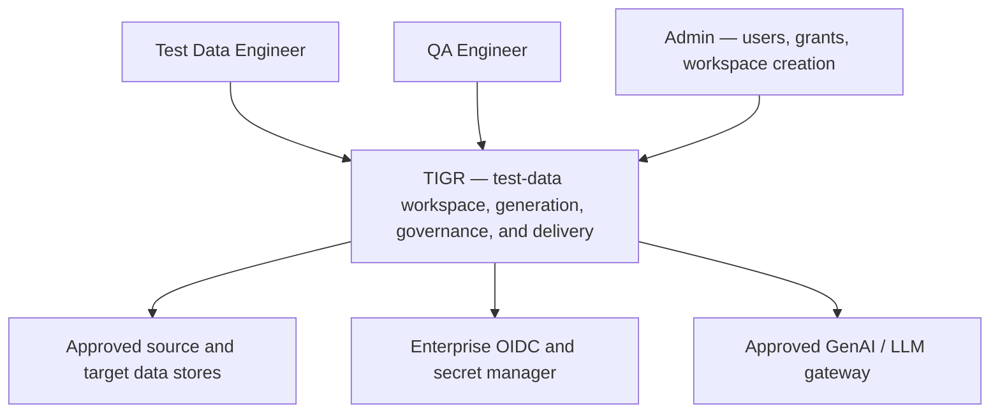
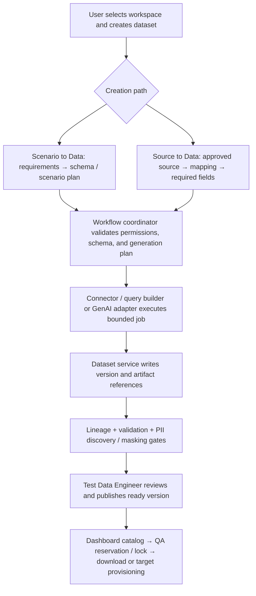

# TIGR MVP1 — Phased Implementation Plan for Codex

**Purpose:** Guide Codex through implementation of the TIGR MVP1 solution in small, verifiable phases.  
**Product:** TIGR — Test-data Intelligence, Generation & Readiness  
**Status:** Implementation guide derived from the current MVP1 BRD, TSD, and HTML prototype.

## 1. Source documents and precedence

Use these documents together when implementing:

1. `1-TIGR_MVP1_Business_Requirements_baseline.md` — business scope, roles, journeys, requirements, and acceptance criteria.
2. `1-TIGR_MVP1_Technical_Specification_baseline.md` — architecture, APIs, data design, security, and technical acceptance gates.
3. `1-TIGR_MVP1_UI_Prototype_baseline.html` — navigation, page structure, workflows, pop-ups, role views, and specified color palette.

### Source precedence

Apply the following precedence when sources disagree:

1. **BRD — business authority:** controls MVP scope, role responsibilities, user journeys, functional behavior, business rules, and acceptance criteria.
2. **TSD — technical authority:** controls architecture, data model, API, security, and operational design within the BRD scope. It cannot expand MVP scope or override a BRD business rule. For a BRD/TSD conflict about business behavior, follow the BRD and record the conflict for resolution.
3. **UI prototype — visual and interaction reference:** controls intended navigation, page structure, subpages, pop-ups, palette, and example interactions. It does not override BRD behavior or TSD contracts.
4. **This implementation plan — delivery sequencing:** controls phase order, checkpoints, and stop conditions only. It does not change product scope or requirements.
5. **Existing repository — implementation context:** inspect existing patterns and preserve working behavior when compatible with the higher-precedence sources. Record conflicts and propose the smallest compatible change. If an ambiguity cannot be safely resolved from these rules, document it and pause work on the affected item.

The BRD defines **what** MVP1 must do; the TSD defines **how** the system is designed; the prototype shows **how users move through the UI**. Do not create parallel implementations merely to match a proposed file layout.

## 2. Codex execution contract

Implement **one phase per task/session**. Do not continue into later phases automatically. At the end of a phase:

1. Run the phase’s targeted checks and relevant existing tests.
2. Review the diff for scope, security, and migration issues.
3. Update any affected API/schema/UI documentation.
4. Report what changed, files affected, tests run and results, known gaps, and the next phase’s prerequisites.
5. Stop and wait for an explicit instruction to begin the next phase.

Before editing any phase, inspect repository guidance such as `AGENTS.md`, the project tree, existing migrations, API routes, frontend routes, and test setup. Reuse current patterns and libraries. Avoid unrelated refactors, broad rewrites, and speculative infrastructure. If a prerequisite is missing, implement the smallest safe seam or report the blocker; do not fabricate credentials, external services, production data, or successful security checks.

## 3. Product invariants and MVP1 boundaries

Keep these invariants true across all phases:

- A **data set** is TIGR’s primary managed object. Jobs, files, query results, and exports are evidence or artifacts associated with a data-set version; they are not substitutes for the data-set record.
- A **workspace** is the operating and access scope for its users, connections, mappings, policies, jobs, and data sets. Source/target connections must be configured, tested, and explicitly saved/enabled before use.
- Both creation paths converge on the same data-set lifecycle and lineage:
  - **Scenario to Data Generation:** text requirement → schema mapping → query development → source-backed or GenAI synthetic data generation.
  - **Source to Data:** select an approved workspace source and saved mapping → select required fields → define criteria, volume and target → generate/provision and validate.
- Each data-set version must have a queryable, user-visible lineage view. Failed or partial jobs, invalid data, and data sets that have not passed applicable privacy and validation gates cannot be published as ready.
- Only a Test Data Engineer publishes a ready data set. QA Engineers consume authorized published versions. Admin manages users, workspaces, and time-bounded access.
- MVP1 human roles are exactly **Test Data Engineer**, **QA Engineer**, and **Admin**. Service identities are non-human principals with explicit scopes.
- Dashboard activity visibility is enforced in the API before filtering, pagination, aggregation, or export:
  - Admin: all TIGR user and job activity.
  - Test Data Engineer: own activity and QA Engineer activity within authorized workspaces.
  - QA Engineer: own activity only.
- Never expose credentials, raw secrets, unmasked PII, raw sensitive samples, or unsafe model/query content in logs, telemetry, errors, browser storage, or exports.
- Implement only the six MVP1 capabilities: Platform Access & Administration; Source Onboarding & Connectors; Scenario to Data Generation; Data Locking & Reservations; PII Data Discovery & Masking; and Data Provisioning & Validation. **Source to Data** is a creation workflow within the MVP1 data provisioning capability, not a seventh capability.

## 4. Target architecture and implementation constraints

Confirm the existing project structure before adding code. Preserve the TSD’s required stack and use bank-approved equivalents for supporting services where needed:

| Layer | Target |
|---|---|
| Web UI | React, TypeScript, Vite |
| API | Python, FastAPI, REST under a versioned prefix such as `/api/v1` |
| System of record | PostgreSQL; pgvector for approved schema/scenario metadata assistance |
| Relationship projection | Neo4j for approved metadata and lineage traversal; PostgreSQL remains authoritative |
| Long-running work | Durable jobs and separately runnable Python workers; Celery/RabbitMQ are TSD defaults if not already using an approved equivalent |
| Artifact storage | Encrypted object/file storage; persist artifact references and metadata, not large files in PostgreSQL by default |
| Identity/secrets | Bank OIDC/OAuth2 SSO and approved secret manager; store references, never connection credentials |
| AI | Provider-neutral model adapter/gateway for schema assistance and synthetic generation |

Keep authorization and workflow rules in backend domain services. Use typed API contracts, migrations, idempotent job submission, safe retries, correlation IDs, and audit events. Do not execute model-generated SQL or query text directly: build a typed plan, validate it against permissions and allowed schemas, then compile it through a restricted query builder. Source reads are read-only, parameterized, bounded, and explicitly approved.

### Architecture views

These views are the implementation baseline. Keep PostgreSQL authoritative for TIGR records and lineage; treat Neo4j as a derived traversal projection. Both data creation workflows converge on the same versioned data-set lifecycle.

#### Overall architecture

```mermaid
flowchart TB
  people["TDE · QA Engineer · Admin"] --> ui["TIGR Web UI"]
  ui --> api["TIGR API and domain services"]
  api --> jobs["Workflow jobs and workers"]
  api --> records["PostgreSQL system of record"]
  jobs --> records
  jobs --> graph["Neo4j lineage projection"]
  jobs --> artifacts["Encrypted artifact storage"]
  jobs --> integrations["Connected sources · targets · GenAI gateway"]
  identity["OIDC · secret manager"] --> api
```

#### C1 — System context



#### C2 — Container view

```mermaid
flowchart TB
  browser["Browser · React / TypeScript UI"] --> api["FastAPI · REST API and domain services"]
  api --> db["PostgreSQL · users, workspaces, datasets, jobs, lineage"]
  api --> queue["Durable queue · Celery / RabbitMQ or approved equivalent"]
  queue --> worker["Python workers · connectors, generation, validation, masking"]
  worker --> db
  worker --> graph["Neo4j · lineage traversal projection"]
  worker --> objects["Encrypted object storage · dataset artifacts"]
  worker --> external["Source / target stores · GenAI gateway · secret manager"]
```

#### C3 — Component flow for dataset creation and publication



The C3 flow is a logical sequence. A job may stop at validation or privacy gates and cannot publish until required checks pass. Lineage is recorded for every dataset version, including source/schema/mapping/query/job and governance actions, or the approved scenario/model configuration for synthetic data.


## 5. Phase sequence and dependency gates

| Phase | Deliverable | Depends on |
|---|---|---|
| 0 | Repository assessment and phase implementation map | None |
| 1 | Shared application foundation and navigable UI shell | Phase 0 |
| 2 | SSO, workspace administration, role grants, and Dashboard | Phase 1 |
| 3 | Workspace connections and schema/structure discovery | Phases 1–2 |
| 4 | Data-set catalog, versioning, common lifecycle, and lineage | Phases 1–3 |
| 5 | Scenario to Data Generation | Phases 2–4 |
| 6 | Source to Data workflow | Phases 2–4 |
| 7 | PII discovery, policy review, masking, and release gates | Phases 3–6 |
| 8 | Reservations, exclusive locks, and fencing | Phases 2, 4, 7 |
| 9 | Target provisioning, exports, cleanup, and expiry | Phases 3–8 |
| 10 | End-to-end verification, security, operational readiness, and MVP1 sign-off | Phases 1–9 |

Phase 5 and Phase 6 are separate creation workflows; both must use the shared data-set and lineage services from Phase 4. Phase 7 provides common privacy controls. Do not create a parallel data-set catalog or separate lineage model in either workflow.

### BRD acceptance traceability

| BRD acceptance area | Implementation phase(s) |
|---|---|
| SSO, three roles, workspaces, Admin workspace creation, and time-bound grants | 2 |
| Role-scoped Dashboard and activity visibility | 2, 10 |
| Workspace connections, schema preview, test, and save/enable | 3 |
| Scenario to Data Generation | 4, 5, 7 |
| Source to Data | 4, 6, 7, 9 |
| Versioned data sets and visible per-version lineage | 4–10 |
| PII review, masking, and publish gates | 7 |
| QA reservations, locks, downloads, and Admin override | 8, 9 |
| Target validation, exports, cleanup, and expiry | 9 |
| End-to-end MVP1 acceptance, security, and operations | 10 |

## 6. Phase 0 — Repository assessment (no product feature changes)

### Objective

Understand the current repository and produce a concrete implementation map before writing or changing product code.

### Codex tasks

- Read repository-specific instructions and identify frontend, backend, migrations, workers, tests, configuration, and deployment boundaries.
- Identify existing authentication, workspace/project concepts, role/permission checks, connection/secret handling, job queues, audit, data-set/catalog, lineage, PII, and export implementations.
- Compare existing structures to the BRD/TSD/prototype. Identify reusable components, missing capabilities, conflicting schemas, and data migration risks.
- Propose the smallest safe sequence for Phases 1–10 and list any bank/environment inputs that cannot be inferred.
- Do not change application behavior or add new feature code in this phase. A short assessment note is acceptable if the user requested it or repository workflow requires it.

### Exit gate

- Repository structure and relevant instructions are understood.
- Existing implementations are mapped to MVP1 requirements.
- Planned files/modules/migrations and phase dependencies are identified.
- No feature changes were made.

## 7. Phase 1 — Shared foundation and UI shell

### Objective

Establish or align the app foundation without implementing business workflows prematurely.

### In scope

- Confirm or establish the React/TypeScript/Vite, FastAPI, PostgreSQL/pgvector, and Neo4j integration boundaries.
- Confirm typed API contract conventions, error shape, pagination, correlation IDs, and health/readiness checks.
- Establish migration and test patterns, job/outbox abstractions, audit-event interface, and secret-reference interface, reusing existing repository components.
- Build the authenticated app shell: specified color palette, navigation groups, active workspace selector, role preview/development fixture where appropriate, responsive header/sidebar, and route guards.
- Add route placeholders for Dashboard and all MVP1 workflow pages, including Data sets, Scenario to Data, Source to Data, Connections, PII & Masking, Reservations & Locks, Jobs, Access & Roles, and Activities & Audit.
- Add UI primitives for tables, status badges, alerts, forms, step navigation, confirmation dialogs, and modal windows; align with the HTML prototype.

### Out of scope

- Real role grants, data-set workflows, connectors, model calls, masking, and lock behavior. Use clearly labeled development fixtures only where needed to exercise the shell.

### Verification and exit gate

- App starts using the repository’s documented commands.
- Every required route loads and navigation works without dead links.
- Responsive layout and selected palette are applied.
- API health/readiness and migration/test commands are documented or discoverable.
- Existing tests still pass; new route/shell checks cover essential navigation.

## 8. Phase 2 — Identity, workspaces, access, and Dashboard

### Objective

Implement the three-role authorization model, Admin workspace management, and the required landing Dashboard.

### Backend

- Integrate the bank’s configured OIDC/OAuth2 identity provider through existing auth patterns. Do not hard-code users or credentials.
- Implement workspace creation, edit, activate/deactivate, list/detail, membership, and initial access grants. Admin can create workspaces.
- Implement exactly the three human role values. Keep service identities distinct and explicitly scoped.
- Support scoped and time-bounded access grants for workspaces, data sets, reservations, and locks. Enforce grant start, expiry, revocation, and fail-closed behavior in APIs and jobs.
- Add audit events for login/session context where applicable, workspace changes, grants/revocations, and administrative actions.
- Implement Dashboard summary/activity APIs. Apply role visibility in backend queries before count aggregation, pagination, search, export, or drill-down.

### Frontend

- Build Admin workspace create/edit/status flows and initial membership setup.
- Build user/role/workspace access screens and a time-bound grant modal.
- Implement Dashboard cards for activities, data sets, jobs by status, reservations, locks, and connected-source count, with authorized drill-downs.
- Enforce the activity rules exactly: Admin sees all TIGR activity; Test Data Engineer sees own and QA Engineer activity in authorized workspaces; QA Engineer sees own activity only.
- Show active workspace context and handle workspace switching without displaying information from the previous workspace.

### Verification and exit gate

- Authorization tests cover all three roles, object/workspace boundaries, expired/revoked grants, and service identities.
- Dashboard tests prove filtering happens before aggregation, pagination, and export.
- Admin can create and manage a workspace; unauthorized roles cannot access Admin actions.
- No role or activity leakage through summary counts, errors, or client-side route access.

## 9. Phase 3 — Workspace source and target connections

### Objective

Allow Test Data Engineers to configure, inspect, test, and save supported connections for workspace use.

### In scope

- Relational databases; JSON; CSV; and structured delimited-text sources/targets.
- Workspace-scoped connection create/edit/disable, connector type, environment, purpose, owner, operation scope, secret reference, and lifecycle.
- Connection lifecycle: draft/configure → structure preview → connection/access test → save/enable or remain disabled.
- Schema and file-structure preview with nested JSON objects/arrays where supported.
- Sanitized actionable connection errors and audit events for configuration and testing.
- Source/target inventory page, add/edit modal, connection test result modal, and status display.

### Guardrails

- Do not store credentials in app tables or return them to the browser; use secret references.
- Do not allow untested/disabled connections into generation or provisioning jobs.
- Do not log query samples or sensitive records during preview.

### Verification and exit gate

- Connector contract tests cover supported types, access failure, malformed structures, timeout, and redacted errors.
- A successful test is followed by an explicit save/enable transition.
- Connection records and discovered schema are workspace-scoped and auditable.
- UI displays connection status, structure preview, test outcome, and saved state.

## 10. Phase 4 — Data-set core, versioning, and lineage

### Objective

Build the shared data-set lifecycle and lineage foundation before implementing either creation workflow.

### Data and services

- Implement or adapt `DataSet` and immutable `DataSetVersion` records. At minimum capture workspace, owner, creation pathway, schema/field scope, source/synthetic provenance, privacy state, validation state, publication/readiness state, expiry, and permitted-use scope.
- Implement version-scoped `DataSetLineageEvent` records with ordered parent/child references, event/stage, safe source/artifact references, mapping/scenario/job/policy/validation versions, actor/service, timestamp, outcome, and safe evidence metadata.
- Store authoritative data-set metadata and lineage in PostgreSQL. Neo4j may project approved lineage for traversal/visualization, but must not become the source of truth.
- Implement shared domain services for create draft version, append lineage, transition status, validate allowed transitions, publish, expire, and retrieve lineage.
- Define consistent states and transition rules. Failed/partial output is quarantined or failed; only validated, privacy-compliant versions can be published.
- Add data-set catalog/detail APIs and authorization checks.

### Frontend

- Build Data sets table/catalog, filters, statuses, and a data-set detail pop-up with Overview, Lineage, Validation, and Access tabs.
- Make the Lineage tab the default when a user selects **Lineage** from any data-set row/version.
- Render an ordered graph/timeline and evidence for each lineage step.
- Source-backed/Source to Data lineage: workspace connection → source objects/schema version → mapping version → selected fields/query criteria → job → masking/transformation → validation → publication/version → target/download/use events.
- Synthetic lineage: approved schema → scenario and model/prompt configuration versions → generation job → validation → publication/version → target/download/use events.
- Do not display raw sensitive values in lineage evidence. Show protected summaries and links to authorized records.

### Verification and exit gate

- Unit/integration tests cover version immutability, allowed state transitions, lineage ordering, missing-parent detection, and authorization.
- Every data-set row has a working detail/lineage view.
- Lineage survives retries and version updates without linking events to the wrong data-set version.
- PostgreSQL remains authoritative; graph projection failure does not corrupt or block authoritative lineage persistence.

## 11. Phase 5 — Scenario to Data Generation

### Objective

Implement the AI-assisted workflow from natural-language test requirement to a validated draft data set.

### Workflow pages

1. **Text requirement:** capture scenario, expected states, volume, exclusions, target use, and ask clarifying questions when intent is material or ambiguous.
2. **Schema mapping:** map intent to approved relational/JSON metadata, fields, keys, and relationships; let the Test Data Engineer review/correct mappings.
3. **Query development:** create a typed logical plan, preview source/scope/estimated count, and compile only validated plans to bounded SQL/JSON queries.
4. **Data generation:** route to approved source-backed retrieval or GenAI synthetic generation using the reviewed scenario plan; create a draft data-set version and lineage.

### Implementation controls

- Keep the AI provider behind a provider-neutral adapter.
- Use only metadata and scenario details authorized for the actor. Do not send raw production records or PII to the model.
- Never execute model-generated SQL/query text directly. Compile through a restricted query builder with allowlists, parameter binding, read-only semantics, row/time/cost limits, and connector capability checks.
- Require explicit user review/confirmation before source extraction.
- Synthetic output must conform to schema, required fields, constraints, relationships, and scenario rules. Use bounded repair based only on schema/error summaries; quarantine after retry limits.
- Record model/provider, model/prompt version, schema version, settings, usage, latency, validation outcome, and artifact hash in safe metadata.
- Create the draft `DataSetVersion` before or transactionally with the job so job output and lineage remain traceable through failure/retry.

### Verification and exit gate

- Tests cover ambiguous intent, mapping edits, relational/JSON query compilation, SQL AST/parameter validation, permission-scoped metadata retrieval, source approval, bounded preview, synthetic schema validation, repair limit, and quarantine.
- A successful run creates a data-set version with complete lineage; an unsafe or failed run cannot be published.
- UI substeps, Back/Continue, save draft, and data-set detail/lineage navigation work.

## 12. Phase 6 — Source to Data

### Objective

Implement the second, field/mapping-driven creation pathway using the approved name **Source to Data**.

### Workflow pages

1. **Select source:** choose a saved/enabled workspace connection and approved mapping.
2. **Map fields:** select required fields and relationships; include mandatory keys/dependencies; allow review/correction within the permitted model.
3. **Generate data:** provide allowed criteria, volume, format, and target; show a protected preview and require confirmation before source access or generation.
4. **Validate & publish:** run schema, field coverage, relationship, privacy, and target validations; create the data-set version and expose publish only after gates pass.

### Implementation controls

- Use a workspace-scoped, versioned field mapping. Capture mapping version and selected fields in lineage.
- Reuse the Phase 4 data-set, job, lineage, masking, and validation services; do not make a second catalog or lifecycle.
- Keep source reads read-only, parameterized, limited, and auditable. Protect previews and apply data minimization.
- Source to Data output starts as a draft/processing version and is not QA-visible until published and access is granted.

### Verification and exit gate

- Tests cover source/mapping authorization, required-field dependencies, selected-field validation, constraints/relationships, protected preview, job failure, and complete lineage.
- UI Back/Continue navigation and all four subpages work at desktop and narrow viewport widths.
- Data set creation path is labeled **Source to Data** in route/page headings, catalogue metadata, job displays, and user-facing messages.

## 13. Phase 7 — PII discovery, masking, and publication gates

### Objective

Prevent sensitive or unmasked data from being published for QA use.

### In scope

- PII/sensitive-field discovery and review/correction by Test Data Engineers.
- Masking-policy upload/create, preview, versioning, approval/review, assignment, and enforcement.
- Supported transformations: tokenization, substitution, redaction, date shifting, and numeric transformation, according to configured policy.
- Masking run, validation evidence, release gate, and quarantine/cleanup on failure.
- Policy upload/review UI, findings queue, coverage summary, and data-set version status.

### Guardrails

- Never export original PII. No dataset requiring masking can be published until the applicable masking validation passes.
- Ensure consistency of tokenization across related records where policy requires it.
- Avoid sensitive values in logs, prompts, browser previews, and lineage event payloads.
- AI can suggest classifications or mappings but cannot approve a policy or publish a data set.

### Verification and exit gate

- Tests cover classification review, policy version changes, transformation consistency, PII leakage checks, failure quarantine, and publication blocking.
- Data-set lineage links the policy/version and masking run to the exact data-set version.
- Published dataset UI clearly shows privacy/masking state and validation evidence.

## 14. Phase 8 — Reservations, locks, and access windows

### Objective

Let QA Engineers plan use and prevent conflicting concurrent use of a data-set version.

### In scope

- Catalog search and authorized data-set availability.
- Time-bounded reservations for planned future use.
- Exclusive lock leases for active test execution, with inspect, acquire, renew, release, expiry, fencing token, and conflict handling.
- Admin grant/revoke access to workspace/data set/reservation/lock for specific periods.
- Admin force-release only with an elevated permission, reason, and audit record.
- Download/integration action is authorized against current access and privacy state and audited.

### Implementation controls

- Reservations are planned windows; locks are active exclusive leases. Do not treat them as interchangeable.
- Enforce acquisition/conflict checks transactionally in PostgreSQL. Use stable allocation scope where safe; otherwise lock the whole version.
- Revalidate actor, access grant, data-set status, and fencing token before worker writes. Expired/stale tokens must stop safely.
- TIGR guarantees only TIGR-mediated exclusivity; do not claim to control manual access outside TIGR.

### Verification and exit gate

- Concurrency tests cover overlapping reservations/locks, renewal/release, expiry, stale worker, fencing, and audited Admin override.
- QA sees only authorized published versions; its dashboard/activity remains self-only.
- Admin sees all activity across TIGR; role filters are consistent in UI, APIs, and exports.

## 15. Phase 9 — Target provisioning, exports, cleanup, and expiry

### Objective

Deliver approved data sets to configured database/file targets and expose safe reporting and lifecycle cleanup.

### In scope

- Target preflight and provisioning to configured database and file targets.
- Pre/post checks for target connectivity, schema, field coverage, record counts, relationships, and constraints.
- Durable provisioning job status, safe reruns, idempotency, partial failure handling, reconciliation, cleanup, and expiry.
- Authorized CSV exports for allowed summaries, audit, connection inventory, query/validation reports, catalogue/reservation/lock reports, masking coverage, and job status.
- Automation-friendly data-set download/output; keep third-party automation integrations behind documented formats/adapters unless explicitly required by the repository.
- Add target/download/provisioning and cleanup events to per-version lineage.

### Export controls

- Enforce the same workspace, role, data-set, and PII policies as the source UI/API.
- Never export unmasked PII. Neutralize spreadsheet formula-leading cells; apply row/size limits; use expiring artifact links; audit export creation and download.

### Verification and exit gate

- Tests cover successful and failed target writes, schema mismatch, count/relation reconciliation, retries, idempotency, cleanup, expiry, export authorization, formula injection, row limits, and artifact expiry.
- Lineage shows target and authorized download events linked to the exact data-set version.
- No invalid, partial, expired, or unpublished dataset is presented as ready.

## 16. Phase 10 — End-to-end verification and MVP1 readiness

### Objective

Verify that the six capabilities work together as one secure lifecycle.

### End-to-end journeys to verify

- Admin signs in, creates a workspace, grants time-bound access, and reviews all TIGR activity.
- Test Data Engineer creates a workspace connection, previews schema, tests and saves it, creates a data set through Scenario to Data, applies/reviews masking, validates, publishes, and inspects lineage.
- Test Data Engineer creates a data set through Source to Data, chooses an approved source/mapping/fields, validates, publishes, and inspects lineage.
- QA Engineer sees authorized published data sets only, reserves one, locks it during test execution, downloads/integrates it, releases it, and sees only own activity.
- Failed connector, model, masking, validation, target, and cleanup jobs remain visible as failed/quarantined states and never become ready.

### Quality and operational checks

- Unit, API authorization, connector contract, migration, worker recovery/idempotency, privacy, lineage, UI accessibility/responsive, and end-to-end tests.
- Verify audit availability and no sensitive data in logs/traces/errors.
- Verify backup/restore and graph projection rebuild approach if these services are used in the repository.
- Run representative load checks and record baselines; do not invent performance targets absent from the bank’s confirmed workload/SLOs.
- Update setup, migration, configuration, test, and operational documentation.

### MVP1 release gate

- All BRD MVP1 acceptance criteria and TSD technical acceptance gates are mapped to a passing test, a reviewed demonstration, or an explicitly recorded dependency.
- No open critical/high security, privacy, data integrity, access control, or lineage defects.
- All six capability areas and the Dashboard are reachable through the application navigation with role enforcement.
- Codex stops after reporting the release gate results; deployment/production rollout is a separate explicitly authorized task.

## 17. Cross-phase API and data requirements

Use the repository’s naming conventions, but keep equivalent typed resources for:

- Identity context, workspaces, memberships, roles, and time-bound access grants.
- Workspace source/target connections, connection tests, source objects/fields, schema versions, and Source to Data mappings.
- Scenarios, plans, mapping edits, query plans, and generation mode.
- Data sets, immutable versions, jobs/job steps, validation findings, publication, lineage events, and artifact references.
- PII findings, masking policies/rules/versions, masking runs, and validation evidence.
- Reservations, locks, fencing tokens, force-release reason, and usage/download audit.
- Provisioning runs, target checks, CSV export jobs, expiring download artifacts, cleanup, and expiry.

API responses must use opaque identifiers, safe errors, pagination, authorization at object level, idempotency keys for job creation/writes, and correlation IDs. Workers retain the initiating actor and approved scope, then reauthorize before performing sensitive actions.

## 18. UI workflow and visual requirements

Keep the prototype’s information architecture and role behavior:

- Dashboard landing page; Data sets; Scenario to Data; Source to Data; Connections; PII & Masking; Reservations & Locks; Jobs; Access & Roles; Activities & Audit.
- Scenario to Data subpages: Text requirement → Schema mapping → Query development → Data generation.
- Source to Data subpages: Select source → Map fields → Generate data → Validate & publish.
- Data-set detail pop-up with Overview, Lineage, Validation, and Access tabs; make lineage directly reachable from each version row.
- Pop-up flows for workspace create/edit, connection setup/test, masking policy upload/review, access grant, reservation/lock, and publish confirmation.
- Admin-only workspace/access management routes; role switchers may exist only in non-production demo/test mode.
- Use the specified palette: Primary `#6428B4`, Dark Purple `#3D176F`, Secondary Purple `#8A42D7`, Orange `#F28C28`, Yellow `#F5C842`, Cyan `#26A9E0`, Charcoal `#292929`, Light Grey `#F2F2F2`, White `#FFFFFF`.
- On small screens, maintain usable route navigation, step controls, dialog close/submit actions, and non-overflowing tables/forms.

## 19. Codex phase completion report template

At each phase checkpoint, report:

```text
Phase completed:
Scope implemented:
Key files and migrations changed:
API/UI behavior delivered:
Tests/checks run and results:
Security/privacy/lineage checks:
Known gaps or blocked dependencies:
Next phase prerequisites:
Confirmation that no later phase was started:
```

## 20. First Codex prompt

Use this prompt to begin Phase 0:

> Read `TIGR_MVP1_Codex_Phased_Implementation_Plan.md`, the current TIGR MVP1 BRD and TSD, and the current HTML prototype. Perform **Phase 0 only**. Inspect repository guidance and existing implementation, then produce the repository assessment and phase implementation map. Do not implement product features or start Phase 1. Report the findings using the Phase completion report template and stop.

For each later phase, explicitly name its number and title, instruct Codex to implement **that phase only**, and require the phase exit gate before it stops.
