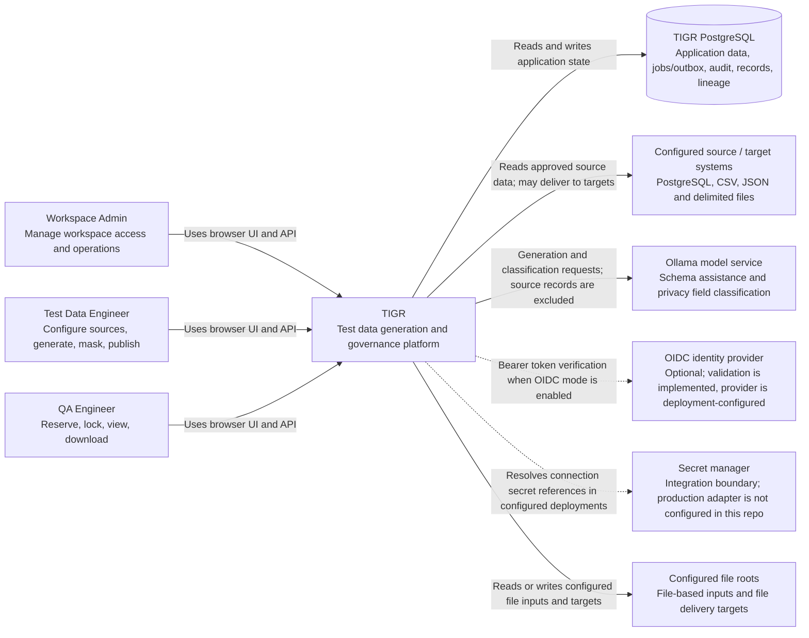
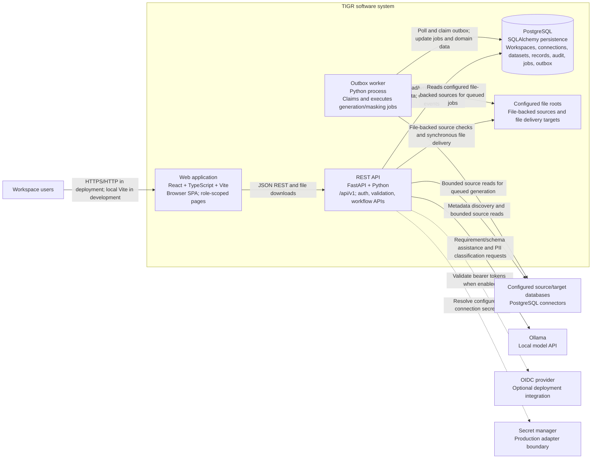
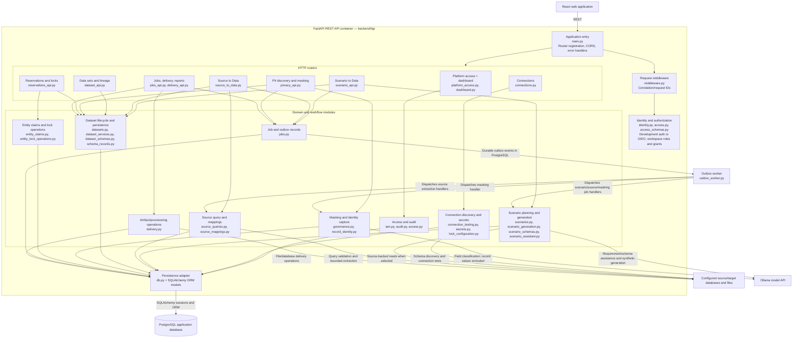
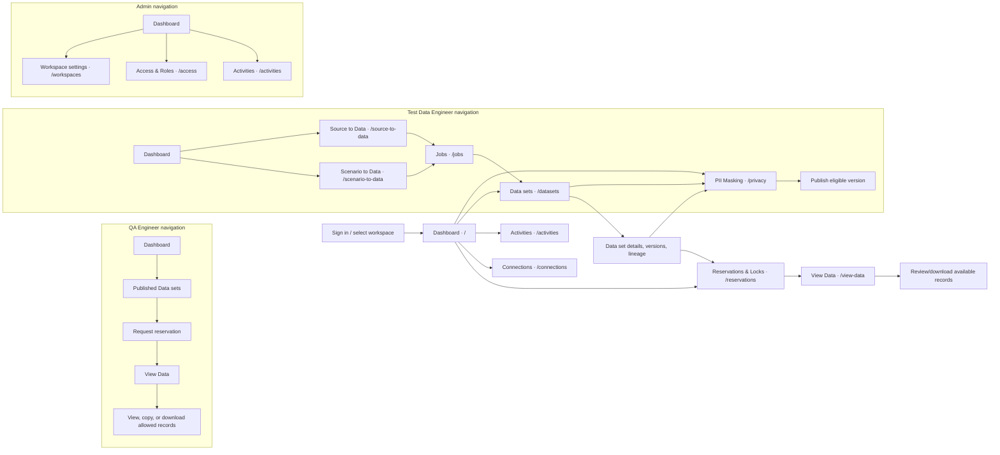
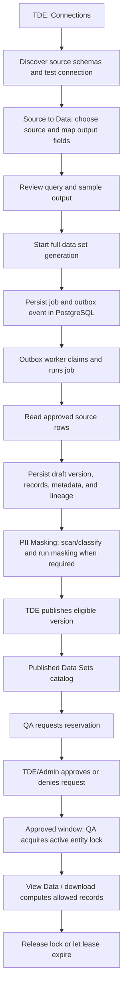
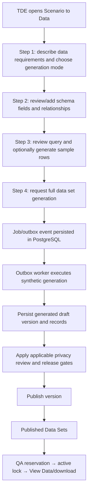
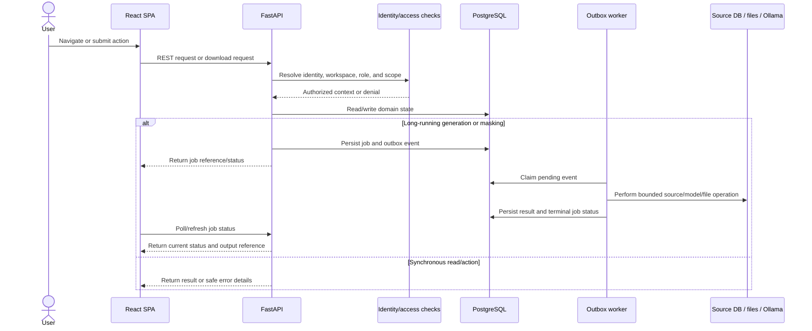

# TIGR Architecture Diagrams (C1–C3)

These diagrams describe the current repository structure and runtime behavior. C1 shows TIGR in its environment, C2 shows deployable/runtime containers, and C3 expands the FastAPI container into its main code components. Module names are included to make the diagrams traceable to the source.

## C1 — System Context

TIGR is the test-data workflow system used by workspace administrators, Test Data Engineers, and QA Engineers. It coordinates source-backed and synthetic data generation, privacy review, publication, reservations, record-level locks, viewing, and delivery.



Dashed relationships indicate optional deployment integrations. Neo4j is intentionally omitted from active connections: the repository reports the graph store as not configured, and PostgreSQL is authoritative for lineage.

## C2 — Container Diagram

The browser UI, API, and background worker are separate runtime processes. The API and worker share PostgreSQL; the worker claims durable outbox events and runs generation or masking jobs. In local development, Vite proxies `/api` to the API process.



**Container notes**

- The API is started from `backend/tigr/main.py`; its routers share a SQLAlchemy session factory from `backend/tigr/db.py`.
- The worker runs as `python -m tigr.outbox_worker`. It consumes scenario generation, source generation, source-query generation, and masking events from PostgreSQL.
- The database stores domain state, generated dataset records/artifact metadata, and queued work. The repository does not use a separate message broker.
- Connection discovery supports PostgreSQL and configured file connectors. Secret resolution is environment-based in local development; a production secret-manager adapter remains deployment work.
- The Ollama client is implemented in `backend/tigr/scenario_assistant.py` and used by schema/query assistance, synthetic generation, and PII classification. Source record values are excluded; synthetic generation can include prior generated identity values so new versions avoid reusing them.
- File roots are configured through `TIGR_FILE_ROOTS`. The app database is separate from configured source/target PostgreSQL databases.

## C3 — REST API Components

This diagram expands the FastAPI API container. Components are logical Python modules, not independently deployed services. Several routers use SQLAlchemy models directly as well as shared domain helpers.



## Repository anchors

- Runtime and routers: `backend/tigr/main.py`
- Configuration and persistence: `backend/tigr/config.py`, `backend/tigr/db.py`
- Browser routes and API client: `frontend/src/App.tsx`, `frontend/src/api.ts`
- Background job execution: `backend/tigr/jobs.py`, `backend/tigr/outbox_worker.py`
- Current system behavior and integration limits: `README.md`

## Component Navigation and Workflow Flows

The diagrams below connect the architecture to the paths a user follows in the application. UI routes are registered in `frontend/src/App.tsx`; backend route groups are mounted by `backend/tigr/main.py`. Authorization is also enforced by the API, so hiding a navigation link is not the security boundary.

### Role-scoped application navigation



QA navigation focuses on published data sets, reservation/lock operations, and View Data. Scenario to Data, Source to Data, Jobs, and Configure navigation are hidden for QA Engineers; the View Data route is role-gated. Workspace and Access & Roles settings are Admin-only. TDEs use the generation and configuration routes. Dashboard activity and request links take users to the corresponding workflow pages.

### Source-backed data set lifecycle



The generation request is durable: the API records job/outbox state in PostgreSQL and the worker performs the long-running work. The generated version moves through draft and privacy/release review before it becomes available in the published catalog. Reservations define an allowed time window; active entity locks control which records are available to another user.

### Synthetic Scenario to Data lifecycle



Schema generation, sample generation, and full data set generation are distinct workflow jobs. Step 3 sample rows are a preview; Step 4 is the full data set generation. A saved draft resumes at its saved step/job state where applicable.

### Reservation, entity locking, and record access

```mermaid
sequenceDiagram
    actor QA1 as QA Engineer 1
    actor QA2 as QA Engineer 2
    participant UI as React UI
    participant API as FastAPI routers
    participant Claims as Entity claim / lock operations
    participant DB as PostgreSQL

    QA1->>UI: Request reservation for published data set
    UI->>API: Create reservation request
    API->>DB: Persist request and audit event
    Note over QA1,DB: Approval grants a time window; reservation alone does not reserve every record.
    QA1->>UI: Acquire lock during approved window
    UI->>API: Acquire entity lock
    API->>Claims: Resolve configured entity identity keys and claim records
    Claims->>DB: Check conflicts and persist active claims/lease
    DB-->>UI: Lock lease result

    QA2->>UI: Open View Data or download
    UI->>API: Request records and access summary
    API->>Claims: Filter records against other users' active claims
    Claims->>DB: Read lock claims and dataset records
    DB-->>UI: Allowed records plus blocked count/message
    Note over QA2,UI: If no records are available, the UI blocks CSV download.

    QA1->>UI: Release lock (or lease expires)
    UI->>API: Release lease
    API->>Claims: Close claims for the lease
    Claims->>DB: Persist release/expiry state
```

Entity keys determine record identity and lock conflicts. Approved propagation paths and manual relationships are not part of the current lock-configuration UI; access filtering uses the configured entity key fields. A user’s own active lock does not hide that user’s records from their own View Data/download flow, while another user’s active claims can hide overlapping records.

### API request and background job path



Use this sequence as the common operational path for tracing a screen action: identify the React page/API client, the registered router, its authorization and domain modules, persistence, and—when an outbox event is created—the worker handler.

These diagrams are a code-oriented snapshot. Deployment topology, production identity provider, production secret manager, and external database inventory must be confirmed against the deployment environment.
